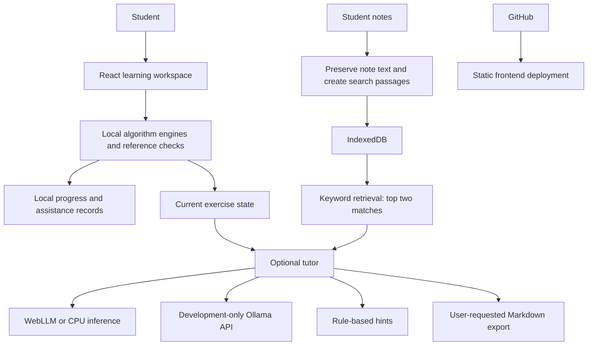

# PatternOS

[Live website](https://patternos-learn.vercel.app/) · [GitHub repository](https://github.com/KunalRawat10/pattern-os)

A lightweight DSA learning workspace. Students predict, trace, repair and apply algorithms; optional AI helps explain their current step. Executable checks determine workshop results independently of the model.

## Journeys

Contains Duplicate; Container With Most Water; Longest Substring Without Repeating Characters; Minimum Window Substring. Changing requirements teach Sets, frequency Maps and position Maps. Fresh checks record corrections and opened help, not general mastery or coding certification.

## Run and validate

```sh
npm ci
npm run dev
npm run test:tutor
npm run build
npm run preview -- --host 127.0.0.1 --port 4180
```

Use the URL printed by Vite. Rebuild before production preview. If the server stops, a saved offline pack may reopen an older version. Refresh the saved pack after publishing updates.

## AI and retrieval

Basic Lite is rule-based, not generative AI. Browser models run through WebLLM/WebGPU or the CPU worker, with separate model downloads and hardware limits. Installed Ollama is supported through a development-only Vite proxy; it is not an inference backend hosted on Vercel. No paid cloud LLM API is configured.

Notes are saved as documents and searchable passages in IndexedDB without a model download. They support editing, draft recovery, filtering, export/import and undo of the last deletion during the current visit. Chat uses lightweight keyword-overlap retrieval of up to two chunks and injects them into AI generation context. This is a basic retrieval-augmented path, not semantic chat retrieval or a guarantee of answer faithfulness. Lite note quotations alone are not generative RAG.

Tutor shortcuts draft editable requests for one step, an analogy, a prediction check or an approach comparison. Conversation download exports Markdown without internal annotations. A transcript is not verified assessment evidence.

## Architecture



The application controls workshop tools. The LLM does not autonomously choose and call tools. There is no agent loop; do not describe this as a multi-agent system.

## Demo and capstone submission

- [Workshop guide](docs/WORKSHOP_GUIDE.md)
- [Recording script and exact prompts](docs/VIDEO_RECORDING_GUIDE.md)
- [Requirement audit](docs/CAPSTONE_AUDIT.md)

Public frontend: https://patternos-learn.vercel.app/. New local features appear there only after a successful push/deployment. No API key belongs in client-side variables or Git. Physical low-end hardware performance and improved learning outcomes have not been established.

## Latest learning tools

- Pattern Atlas explains topic relationships and links to the four checked workshops. Progress comes from browser workshop records; topics without workshops are unassessed.
- Complexity has six checked teaching models and prediction questions. Custom code review supplies limited text clues, not a proven complexity bound, and never executes pasted code.
- Contains Duplicate has app-checked step help and a printable learning report. Help is labelled separately from AI and recorded as assistance. An independent pass refers to one example, not general mastery.
- Current exercise context is prioritised separately from retrieved notes in model requests. Models can still make mistakes.

## Demonstration without AI

Open Practice → Workshop → Contains Duplicate. Work through Check each number, Compare two methods, Find the mistake, Put the steps in order, and Try it yourself. The exercises, pattern map, notes and complexity models do not require Ollama, a GPU or an AI download.

For desktop AI, install Ollama and a supported model (for example qwen2.5:7b), keep `ollama serve` running, start `npm run dev`, and choose Use installed desktop tutor. This uses only the local development proxy. The public Vercel frontend does not provide that desktop backend. Browser AI requires compatible visitor hardware and a separate model download. No hardware minimum has been established by testing.

## Report evidence

See [Evidence index](docs/REPORT_EVIDENCE_INDEX.md), [Notes tests](docs/NOTES_TEST_RESULTS.md), [Complexity tests](docs/COMPLEXITY_TEST_RESULTS.md), [Core learning tests](docs/CORE_LEARNING_TEST_RESULTS.md) and [Final workshop rehearsal](docs/FINAL_LEARNING_REHEARSAL.md). These documents distinguish local browser checks, automated tests and real-model limitations.
