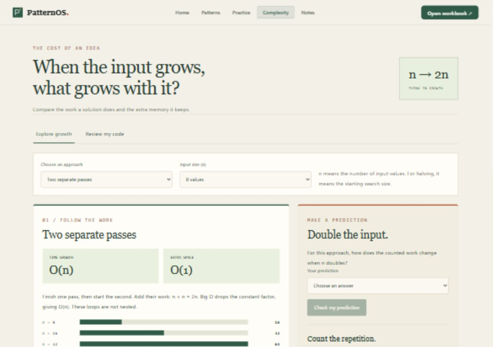

# Complexity module — functional test evidence

Date: 6 November 2026. Browser test address: http://127.0.0.1:5192/complexity.

The former analyzer inferred O(n²) from a count of two loops even when the loops were separate. The revised module provides checked teaching examples and a separate, explicitly limited JavaScript text-clue review.

| Scenario | Browser observation | Result |
|---|---|---|
| Two separate passes | O(n), O(1) extra space; n=8/16/32 gives 16/32/64 visits | Pass |
| Prediction | Choosing It doubles produces matching feedback with 16 and 32 visits | Pass |
| Full nested pairs | n=100/200/400 gives 10,000/40,000/160,000 checks and O(n²) | Pass |
| Halving | Starting sizes 100/200/400 give 6/7/8 halving steps | Pass |
| Set model | Shows expected O(n), O(n) space and explicitly states all-distinct/average-cost assumptions | Pass |
| Custom text | Two separate loops plus a comment and quoted loop text yields two headers, without a Big O verdict | Pass |
| Phone layout | At width 390, document width 385; comparison table scrolls within its container | Pass |

Automated tests: 113 passed across the project. Complexity tests compare the count model against instrumented fixed iterations, test halving boundaries and non-power-of-two input, check Set no-repeat counts, and ensure code clues do not produce a complexity verdict. Production build passed.

Counts describe a selected operation in a teaching model. They are not timing benchmarks and should not be compared as equivalent units across different algorithms. No submitted code is executed. Code review is a limited text scan, not parsing, correctness verification or a general static complexity analyzer. It may miss or misread regex literals, template expressions, library calls and non-JavaScript code.

