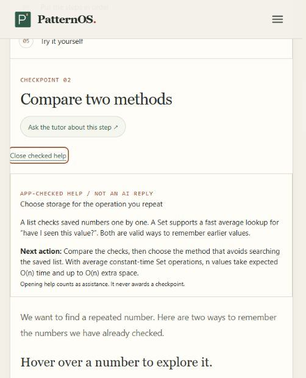

# Core learning updates — test evidence

Date: 6 November 2026. Browser walkthrough used an isolated local origin, port 5193, leaving the main port 5192 workshop record untouched.

## Changes

- Current workshop state is passed separately from retrieved reference notes to full and compact model paths. Long notes no longer displace the current input from the context budget.
- The compact model does not silently replace an unsuitable workshop answer with an unrelated generic teaching answer. Failure stays explicit and the student can use checked help.
- Contains Duplicate has an app-checked help panel for the current stage. It is explicitly labelled as separate from AI chat.
- The trace points into List versus Set selection instead of treating a repeated-value example as the whole lesson.
- Help opening is recorded as assistance. A new independent case closes help and resets the new case's assistance flag when the tutor is closed.

## Browser observations

| Scenario | Observed outcome |
|---|---|
| After saving first 4 in [4,7,4] | Help identifies current 7, saved [4], no earlier 7 |
| After checking 7 | Help prompts Save 7, separate from the check |
| After saving 7 | Help identifies current 4, saved [4,7], earlier matching 4 |
| After finding repeat | Guidance leads to Compare two methods, Set choice and costs |
| Open checked help in fresh case | Current case changes to hint or tutor opened; no checkpoint awarded |
| Start another fresh case | Help closes and new case shows no help opened with tutor closed |
| Open tutor in Lite mode | Use checked workshop help recovery control appears |
| Activate recovery control | Tutor closes; same workshop stage opens app-checked help |

## Automated checks and limits

117 tests passed across the project. New tests cover the exact photographed sequence, separate check/save phases, numeric zero versus string zero, retention of exercise context despite long notes in both model paths, and explicit compact-model workshop failure. Production build and targeted lint passed for the changed helper, workshop, lesson and compact-model files. WebLLMChat has existing repository lint findings; no repository-wide lint-clean claim is made.

Model-path tests used controlled completion responses. Actual local model answer quality was not measured in this run, and this change does not guarantee factual correctness of every generated reply. The checked-help UI was exercised in the browser without loading an AI model. It does not replace the student's independent assessment or certify coding.

