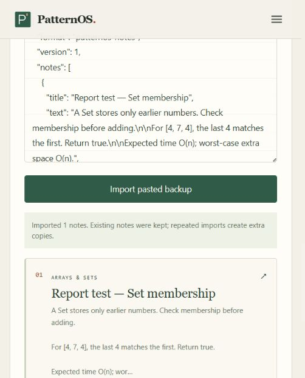
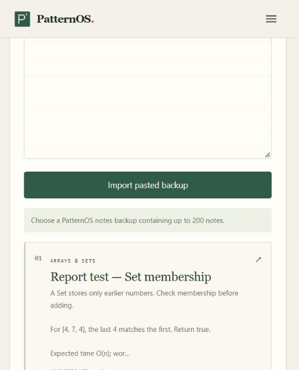

# PatternOS Notes — Functional Test Evidence

Test date: 6 November 2026. Tested locally through the in-app browser at http://127.0.0.1:5193/knowledge using isolated site storage. The original notebook at port 5192 was not changed.

## Observed browser results

| Test | Action | Observed result | Status |
|---|---|---|---|
| Empty note | Open an empty editor | Save note disabled | Pass |
| Draft recovery | Enter title, topic and two paragraphs; reload before saving | All draft fields restored | Pass |
| Save | Save the recovered draft | One note appeared; editor cleared; full content readable | Pass |
| Edit | Change the body and save changes | Same single note updated; no duplicate created | Pass |
| Search | Search for membership; then an absent phrase | Matching note shown; absent phrase showed No matching notes | Pass |
| Topic filter | Choose Sliding Window for an Arrays & Sets note | Note excluded; All topics restored it | Pass |
| Delete | Delete the isolated test note | Saved-note count became zero | Pass |
| Undo | Choose Undo last deletion | Full note restored; count became one | Pass |
| Backup content | Inspect backup generated by the page | Title, topic and updated paragraphs matched saved note | Pass |
| Restore | Paste the generated backup into the restore box | One note imported; existing note kept; total two | Pass |
| Saved-note persistence | Reload after restoring the backup | Both saved notes remained with the edited text | Pass |
| Invalid import | Import {} | Rejected with an explanation; saved count remained two | Pass |
| Direct download | Click Back up notebook | No download event or downloaded file detected in the in-app browser | Unconfirmed |

## Fixes made while testing

- Added an explicit accessible name to the topic filter.
- Hid an open reader when its note no longer matches the current filter.
- Added copy/paste backup and restoration for browsers that block file downloads.
- Attached the export link to the document and delayed URL revocation to improve download compatibility.

## Automated checks

109 automated tests passed. Production build passed. Targeted lint passed for the Notes view and storage/helpers. Tests include preserving original formatting, keeping notes with identical titles distinct, reading older stored notes, and rejecting malformed backups before writing.

## Limits

These are developer-run functional checks, not a user study. Notes are stored per browser and origin; no automatic device sync exists. Undo covers the most recent deletion during the current visit. Import adds notes and can create duplicate copies. Direct download and native file-picker import need a separate Chrome/Opera check. The copy/paste restoration path uses the same backup validator and saving function and was exercised successfully. AI-generated answers using notes were not evaluated in this run; the current tutor retrieves passages using shared keywords.

## Report-ready paragraph

The Notes module was tested through browser-based functional scenarios covering draft recovery, saving, editing, search, filtering, deletion, undo and backup restoration. The tested core operations produced the expected results while preserving note text and topic information. Invalid backup data was rejected without altering existing notes. A copy/paste backup option was added after direct download could not be confirmed in the in-app browser. These results demonstrate the core note-management workflow locally; cross-device synchronisation and AI answer quality were outside this test scope.

## Screenshots

